<p align="center">
  
</p>

<p align="center">
  
</p>

<p align="center">
  <a href="https://azizur-rahman.com">
    
  </a>
  &nbsp;
  <a href="https://linkedin.com/in/azizur-rahman2533">
    
  </a>
  &nbsp;
  <a href="https://x.com/Azizur_rahmanE">
    
  </a>
  &nbsp;
  <a href="mailto:hello@azizur-rahman.com">
    
  </a>
  &nbsp;
  <a href="https://github.com/AzizurRahmanEmon?tab=followers">
    
  </a>
  &nbsp;
  
</p>

<p align="center">
  <a href="#featured-work">Featured work</a>
  &nbsp; / &nbsp;
  <a href="#github">GitHub stats</a>
</p>

---

## `$ whoami`

```ts
const azizur = {
  role:       "Full Stack Developer",
  location:   "Uttara, Dhaka, Bangladesh",
  stack:      ["React", "Next.js", "TypeScript", "Node.js", "PostgreSQL", "MongoDB"],
  building:   ["Shopify apps", "Multi-tenant SaaS", "E-commerce platforms"],
  writes:     "RMN Labs — SEO, Next.js, API security & performance",
  experience: "4+ years · 30+ ThemeForest/CodeCanyon items",
  contact:    "hello@azizur-rahman.com",
};
```

> I build production SaaS and e-commerce — multi-tenant isolation, payments, and storefronts that are ready to bill and ship.

---

## Stack

<table>
  <tr>
    <td valign="top" width="33%">
      <h4>Frontend</h4>
      <p>
        
        
        
        
        
        
        
        
        
      </p>
    </td>
    <td valign="top" width="33%">
      <h4>Backend &amp; Data</h4>
      <p>
        
        
        
        
        
        
        
        
        
      </p>
    </td>
    <td valign="top" width="33%">
      <h4>Auth, AI &amp; Tooling</h4>
      <p>
        
        
        
        
        
        
        
        
      </p>
    </td>
  </tr>
</table>

---

## Featured work

<table>
  <tr>
    <td valign="top" width="50%">
      <h3>Zestify</h3>
      <p>Multi-tenant restaurant SaaS: a Next.js customer app, React admin, and Node/Express API. Reservations, inventory, analytics, Stripe and PayPal checkout, RBAC, tenant isolation, and a provider-agnostic LLM assistant (Gemini, Groq, or Claude). Listed on CodeCanyon.</p>
      <p>
        <a href="https://zestify-client.vercel.app">Live demo</a>
        ·
        <a href="https://github.com/AzizurRahmanEmon/zestify-client">zestify-client</a>
      </p>
    </td>
    <td valign="top" width="50%">
      <h3>Vellure</h3>
      <p>Multi-tenant e-commerce SaaS: tenant-scoped REST API, Vite/React admin, and per-store Next.js storefronts. Stripe subscription billing, webhooks, store provisioning, plan limits, and a plan-gated AI assistant.</p>
      <p>
        <a href="https://vellure-saas.vercel.app">Live demo</a>
      </p>
    </td>
  </tr>
  <tr>
    <td valign="top">
      <h3>Travel Photo Journal</h3>
      <p>A Next.js travel journal with email-verified auth, rotating refresh tokens, TOTP 2FA, Neon Postgres, Drizzle, Cloudinary uploads, and AI-generated summaries.</p>
      <p>
        <a href="https://ar-travel-journal.vercel.app">Live demo</a>
        ·
        <a href="https://github.com/AzizurRahmanEmon/travel-journal-app">travel-journal-app</a>
      </p>
    </td>
    <td valign="top">
      <h3>URLCAP</h3>
      <p>Turn a webpage into a screenshot, GIF, or short video entirely in the browser. Uses the Screen Capture API — no backend, no uploads, no hosting bill.</p>
      <p>
        <a href="https://urlcap.vercel.app">Live demo</a>
        ·
        <a href="https://github.com/AzizurRahmanEmon/urlcap">urlcap</a>
      </p>
    </td>
  </tr>
</table>

---

## Currently

- **Building** Shopify apps
- **Freelancing** since Jul 2025 — 26+ React and Next.js projects for European clients
- **Writing** at RMN Labs on SEO, Next.js, and API security and performance
- **Open to** remote full-time, contract, or freelance work

---

## GitHub

### Contribution calendar

<p align="center">
  <a href="https://github.com/AzizurRahmanEmon?tab=overview">
    
  </a>
</p>

### Contribution snake

<p align="center">
  <picture>
    <source media="(prefers-color-scheme: dark)" srcset="https://raw.githubusercontent.com/AzizurRahmanEmon/AzizurRahmanEmon/output/github-contribution-grid-snake-dark.svg" />
    
  </picture>
</p>

### Stats

<p align="center">
  
  
</p>

<p align="center">
  
</p>

<p align="center">
  
</p>

<p align="center">
  
</p>

---

## Connect

<p align="center">
  <a href="https://azizur-rahman.com">
    
  </a>
  &nbsp;&nbsp;
  <a href="https://linkedin.com/in/azizur-rahman2533">
    
  </a>
  &nbsp;&nbsp;
  <a href="mailto:hello@azizur-rahman.com">
    
  </a>
  &nbsp;&nbsp;
  <a href="https://x.com/Azizur_rahmanE">
    
  </a>
</p>

<br/>

<p align="center">
  <sub><i>Building Shopify apps, multi-tenant SaaS, and marketplace products from Dhaka.</i></sub>
</p>

<p align="center">
  
</p>
